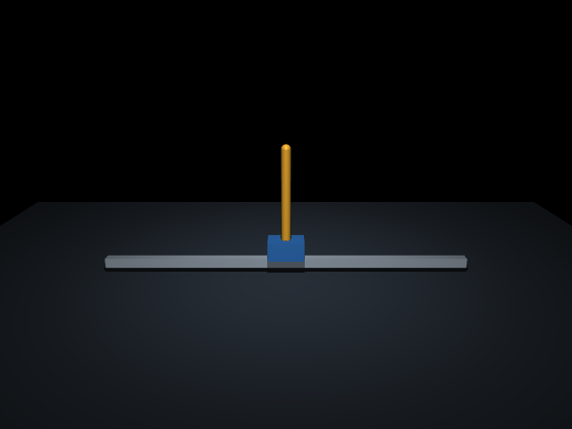
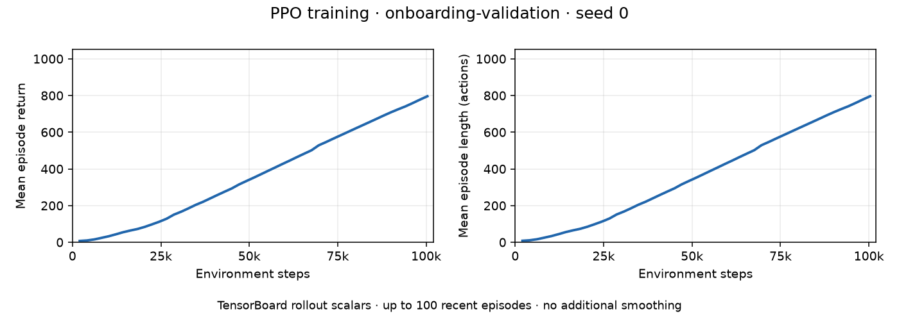

# CartPole report

Replace each TODO with your own observations. Keep this report short; link code,
compact results, and images instead of pasting logs.

To link a file in Markdown, use `[link text](relative/path/to/file)`.
For example, `[Environment code](../onboarding/env.py)` becomes
[Environment code](../onboarding/env.py). Links are relative to this report's
`docs/` folder; use `../` to reach the repository root.
To display an image, add `!`: ``.

## Setup

- Member: Codex validation on behalf of the repository maintainer, 2026-09-20; this is an automated walkthrough, not a beginner pilot.
- OS: Ubuntu 24.04.5 LTS, Linux x86-64 under WSL2 (kernel `6.18.33.2-microsoft-standard-WSL2`); Python 3.12.3; uv 0.12.13.
- Setup diagnostic, viewer, and RGB results; any fix needed: Package imports, CPU tensor, FFmpeg encoder, physics, WSLg viewer, and RGB checks passed. The sandbox initially blocked display access; rerunning the viewer with display access passed. Offscreen `MUJOCO_GL=osmesa` also passed. Writable uv, Matplotlib, and Mesa caches under `/tmp` avoid sandbox cache warnings. No dependency or lockfile changes were needed.
- Fork URL and working branch: No fork created. Existing origin: [grmpn/BSRA-RL](https://github.com/grmpn/BSRA-RL); working branch: `onboarding-validation`, created from `546b21d`. The user explicitly requested local validation, so fork, push, PR, merge, and Discord submission steps do not apply to this run.

## Model and task



[scene.xml](../assets/scene.xml) includes [cartpole.xml](../assets/cartpole.xml),
whose `<mujocoinclude>` contents own the mechanism and motor. The scene supplies
physics options, collision defaults, floor, rail, light, and camera. The cart
slides along x; the pole hinges about y, moving in the x–z plane. Only the cart
has a motor. The box sizes `0.15 0.10 0.08` are half-extents, giving full dimensions
`0.30 × 0.20 × 0.16 m`. XML uses degrees (`hinge` range ±90°), while simulation
angles and angular velocities use radians and radians/second. All geoms inherit
disabled collisions. These settings were checked against the
[MuJoCo XML reference](https://mujoco.readthedocs.io/en/stable/XMLreference.html)
and the compiled model.

Describe the task supplied by Gymnasium in your own words. For each row, identify
the method, attribute, or XML setting you inspected to understand its behavior.

| Component                              | Your explanation of the supplied task |
| -------------------------------------- | ------------------------------------- |
| Observation order, shape, dtype, units | `_get_obs()` concatenates `data.qpos` then `data.qvel`: `[cart x (m), pole angle (rad), cart velocity (m/s), pole angular velocity (rad/s)]`. `__init__()` declares an unbounded float64 Box of shape `(4,)`; joint order comes from the XML. |
| Action range and gear | `env.action_space` is float32, shape `(1,)`, range `[-3, 3]`, from `cart_motor.ctrlrange`. The command enters `data.ctrl`; the unit-gain motor and gear 100 produce slider force `100 × action` N (up to ±300 N). The pole is unactuated. |
| Physics/control timing | `scene.xml` sets RK4 and `model.opt.timestep = 0.02` s. `make_env()` sets `frame_skip = 2`; `env.unwrapped.dt = 0.04` s per action, giving 25 actions and video frames per simulated second. |
| Reset and seeding | `MujocoEnv.reset()` resets simulation data; `reset_model()` adds independent uniform noise in `[-0.01, 0.01]` to each initial position and velocity, then calls `set_state()`. Repeating `reset(seed=...)` reproduces the initial observation. Random actions need their own `action_space.seed()`; identical starting states alone do not reproduce actions. |
| Reward | `step()` first calls `do_simulation(action, frame_skip)`, then reads the resulting observation and sets `reward = int(not terminated)`. A finite observation with absolute pole angle ≤0.2 rad earns 1; failure earns 0. The reward describes the state after the action, and episode return sums these rewards. |
| Termination | `step()` sets `terminated=True` if any observation is nonfinite or the absolute pole angle exceeds 0.2 rad (about 11.46°). Cart position is not a failure condition. This is the balancing task ending, not a time limit. |
| Truncation | `gym.make(..., max_episode_steps=1000)` adds `TimeLimit`, which sets `truncated=True` after 1,000 actions (40 s). The unwrapped task returns false for truncation. Reset after either flag; physical joint limits do not themselves end an episode. |

I inspected the installed Gymnasium 1.2.3 implementation alongside the
[pinned task source](https://github.com/Farama-Foundation/Gymnasium/blob/v1.2.3/gymnasium/envs/mujoco/inverted_pendulum_v5.py).
`env.unwrapped.model` holds compiled parameters; `env.unwrapped.data` is the
mutable `MjData` holding `qpos`, `qvel`, and `ctrl` (see
[MuJoCo structs](https://mujoco.readthedocs.io/en/stable/python.html#structs)).
Reset initializes positions/velocities and returns their concatenation. One step
writes the command to `data.ctrl`, advances MuJoCo twice, concatenates the new
state, then classifies health and computes reward. `TimeLimit` separately counts
actions. Falling is termination; exhausting the action budget is truncation.
XML travel limits are physical constraints, not Python ending checks, and may
allow small solver excursions. Continuing after either ending flag would mix
separate episodes and invalidate returns; reset initializes both task state and
the wrapper's counter.

`test_reward_and_angle_failure` catches a task that always returns reward 1 and
never terminates at ±0.3 rad, even if its API shapes are correct. The expected
SB3 warning recommends normalized `[-1, 1]` actions; this exercise deliberately
retains the specified `[-3, 3]` motor range. The three traced random episodes
ended after 5, 6, and 6 actions, then reset on their next prescribed seeds.

## Training

- Run name / source commit / training seed: `onboarding-validation` / `21e57056ecf8c2aaa9cd7cbb73451f214afaa7f3` (clean source) / `0`. The separate 256-step `onboarding-smoke` run tested plumbing before the implementation commit; its metadata correctly records a dirty starter revision.
- Requested and actual steps / elapsed time / device: 100,000 requested; 100,352 collected (49 complete 2,048-step rollouts); 147.98 s; CPU with one PyTorch thread.
- Configuration and versions: [Full run record](../results/onboarding-validation/run.json). Unchanged `PPO_SETTINGS`: `MlpPolicy`, learning rate 0.0003, rollout 2,048, batch 64, 10 epochs, gamma 0.99, GAE lambda 0.95, clip 0.2. Python 3.12.3, Gymnasium 1.2.3, MuJoCo 3.6.0, SB3 2.7.1, PyTorch 2.10.0+cpu, NumPy 2.4.2, TensorBoard 2.21.0, imageio-ffmpeg 0.6.0.
- Learning curve: 

The horizontal axis is environment actions; the vertical axes show episode
return and length averaged over up to the latest 100 completed training episodes.
TensorBoard was opened at `http://127.0.0.1:6007/`, with only this run selected and
UI smoothing set to **0**. The image plots the same 49 scalar records, also saved
as [curve CSV](../results/onboarding-validation/learning-curve.csv), with no added
smoothing. Mean return rose from 7.32 at step 2,048 to 795.92 at step 100,352;
mean length rose from 8.32 to 796.20. The recorded rolling means improve steadily,
without a final plateau, but averaging hides individual-episode variability.
SB3 implements PPO's rollout collection and updates, PyTorch supplies the neural
networks and optimization, and `Monitor` reports completed episode returns and
lengths for logging. The expected missing-TensorFlow notice did not prevent
TensorBoard from serving these scalar plots.

## Evaluation

Use reset seeds 10000–10019, deterministic PPO actions, and random action seeds
`reset seed + 20000`. Standard deviations describe episodes (`ddof=0`).

| Agent | Episodes | Return mean ± std | Length mean ± std | Time-limit fraction |
| --- | --- | --- | --- | --- |
| Random | 20 | 4.80 ± 2.66 | 5.80 ± 2.66 | 0% |
| PPO | 20 | 1000.00 ± 0.00 | 1000.00 ± 0.00 | 100% |

- Per-episode CSV and summary JSON: [40 episode records](../results/onboarding-validation/episodes.csv) and [evaluation summary](../results/onboarding-validation/summary.json). Every prescribed seed occurs once per agent; the recorded episode is counted once.
- Predetermined PPO rollout (seed 10000): The blue cart makes small corrections while the yellow pole stays upright, then settles slightly left of center. A deterministic replay measured cart positions from −0.0820 to 0.0138 m and pole angles from −0.0296 to 0.0172 rad. It ends by truncation at 1,000 actions, return 1,000, with no fall. Local file: `videos/onboarding-validation/episode-10000.mp4` (640 × 480 H.264, 25 fps, 40 s).
- Limitation or failure, and a specific diagnosis if learning was weak: Learning was strong on this narrow test, but one training seed and tiny near-upright reset noise do not establish robust recovery. There are no imposed pushes, altered masses, noisy sensors, or actuator delays. Zero observed evaluation variance reflects 20 capped episodes, not proof that all starts succeed.

Evaluation freezes one saved policy, uses deterministic actions in fresh
environments, and compares all 20 starts with seeded random actions. The training
curve averages episodes collected while a stochastic policy is changing. One
trained seed cannot establish reproducibility across independent training runs,
algorithm superiority, or robustness outside this reset distribution.

The observation → policy → action → physics → reward loop, explicit control
interval, baseline, and reproducible evaluation carry over to humanoid soccer.
A policy maps observations to actions; the agent here is PPO's policy and the
environment is the custom mechanism plus Gymnasium task. Unlike this contact-free,
fully observed two-joint system, soccer needs contact dynamics, many actuators,
partial/noisy observations, ball/opponent interaction, and physical safety and
sim-to-real validation. The orientation's
[OP3 project](https://sites.google.com/view/op3-soccer/home) describes learned
walking, turning, kicking, and recovery, with dynamics randomization and
perturbations for transfer. Those capabilities are outside this experiment.
A useful next research question is how much observation delay this policy tolerates.

## Reproduce and review

Run from the repository root. These are the commands and cache settings used;
the existing environment allowed offline sync. A fresh clone uses `uv sync` to
download the same locked dependencies. Run viewer and TensorBoard commands with
WSLg/display and localhost access (outside this agent's restricted sandbox).
`MUJOCO_GL=osmesa` is scoped to offscreen checks and video, not the interactive viewer.

```bash
git switch onboarding-validation
export UV_CACHE_DIR=/tmp/bsra-uv-cache
export MPLCONFIGDIR=/tmp/bsra-matplotlib
export MESA_SHADER_CACHE_DIR=/tmp/bsra-mesa
uv sync --offline
uv run python -u scripts/check_setup.py --viewer --rgb
MUJOCO_GL=osmesa uv run python -u scripts/check_setup.py --rgb
uv run python -m pytest test/test_model.py test/test_env.py test/test_pipeline.py -k 'not policy_round_trip and not evaluation'
uv run python scripts/view_model.py
uv run python scripts/view_model.py --control 0.1 --seconds 1
uv run python scripts/view_model.py --control -0.1 --seconds 1
uv run python scripts/evaluate.py --random-only --run-name random-debug --episodes 3 --trace
MUJOCO_GL=osmesa uv run python scripts/evaluate.py --random-only --run-name random-debug --episodes 3 --video
uv run python scripts/train.py --run-name onboarding-smoke --smoke
uv run python -m pytest test/test_pipeline.py
uv run python scripts/train.py --run-name onboarding-validation --seed 0 --steps 100000
uv run tensorboard --logdir runs --host 127.0.0.1 --port 6007
MUJOCO_GL=osmesa uv run python scripts/evaluate.py --policy models/onboarding-validation/policy.zip --run-name onboarding-validation --video
uv run python -m pytest
ffprobe -v error -count_frames -select_streams v:0 -show_entries stream=codec_name,width,height,r_frame_rate,nb_read_frames,duration -of json videos/onboarding-validation/episode-10000.mp4
ffmpeg -v error -i videos/onboarding-validation/episode-10000.mp4 -f null -
```

TensorBoard runs in a separate terminal; stop it with Ctrl+C after inspecting
Scalars. Existing run names intentionally reject training. To reproduce in this
already-populated checkout, choose fresh names (for example `onboarding-repro`)
and use the matching name and policy path for evaluation. A clone of the final
branch also contains committed result directories, so it needs fresh run names.
The original full training run started from clean commit `21e5705` before its
results directory existed. Policies/logs/videos stay under the ignored local
`models/`, `runs/`, and `videos/` directories.

Keep the saved policy, TensorBoard logs, and rollout video locally and share them
directly with the RL lead if requested. No file uploads, download links, or GitHub
release are required for these files.

- Automated test results: Full `uv run python -m pytest`: **17 passed**, one expected SB3 action-range warning, 2.38 s. Model/environment/training checkpoint: 14 passed; pipeline checkpoint: 4 passed. These overlapping checkpoints are not additional unique tests.
- Manual model/render/video checks: WSLg setup and all three bounded viewer trials exited successfully. Inspected the model render and opposite-control frames: after 1 s, controls ±0.1 moved the cart to ±0.4475 m with opposite pole rotation; zero control preserved the upright zero state. Random and PPO video frames show the custom scene. FFmpeg decoded both videos without errors; ffprobe counted 1,000 PPO frames at 25 fps. Browser playback reached the 40 s end without a media error. TensorBoard served real scalar data and its unsmoothed plots were visually inspected.
- Fork PR link and review notes (record merge in the PR): Not applicable: user requested local-only `onboarding-validation`; nothing was pushed or merged. Local review checked the prescribed model/task, unchanged PPO settings, CPU save/load, deterministic evaluation, task/policy hashes, preserved TODO comments, and this template's headings, tables, and every original bullet. Only completed exercises, this report, and compact results/images belong in the commits; private planning files and large generated artifacts remain ignored.

## Feedback

- Did you learn anything from this onboarding? What was new, or what became
  clearer? If little was new, say so: This was an agent validation, so it does not measure a beginner's learning or effort. The walkthrough makes the distinction between XML mechanics and Gymnasium task rules concrete: joint limits do not equal termination, the failing action earns zero, and truncation is imposed by a wrapper. It also verifies the separate reset/action seeds and why training statistics differ from fixed-policy evaluation.
- What improvements would make the onboarding easier to follow or more useful?
  Mention any confusing instructions, missing background, or unnecessary work: Add a small, copyable screenshot/curve-export recipe; clarify that software-rendered video and an interactive WSLg viewer need different display conditions. Explain that committed result directories also reserve run names, so a cloned completed solution needs new names. Explicitly distinguish the InvertedPendulum observation order from classic CartPole examples. A real beginner should still pilot the 8–12-hour estimate. The orientation video could not be fetched by the web reader here; its primary project page and paper summary provided the behavior/transfer context.
